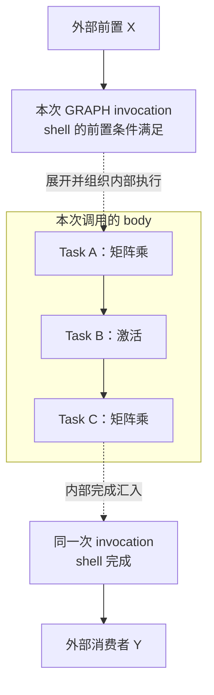
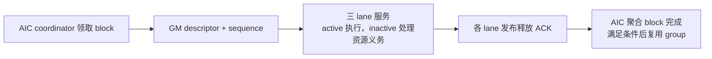
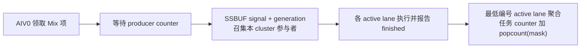
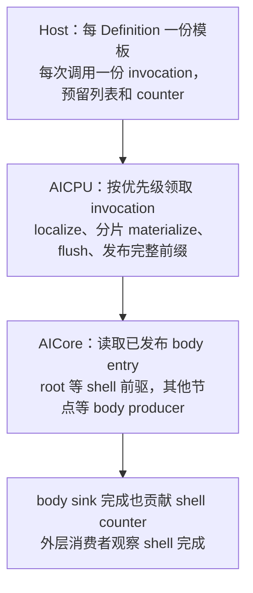

# 每核 resident 与 percounter：协作任务、优化点及性能边界

> 历史资料：本文固定分析旧 resident 142ee15a7 与 percounter 9769943a，不描述当前默认 Ready pool。新版 resident 以 [理解指南](hbg-resident-vs-percounter-guide.zh-CN.md) 为准；原数据结构和性能证据保留用于版本对照。

本文补充[理解指南](hbg-resident-vs-percounter-guide.zh-CN.md)，重点讨论普通任务之外的 Mix、sync-start、GRAPH task。源码范围保持固定：每核 resident 为 `142ee15a7fa46925b9802984fa1ac75676e87d43`，percounter 为 PR #2814 的 `9769943a58f4d7580dd23e6f6eff93067e7e9bbc`。两者不是同一代码基线，以下不是新增硬件测试结果。

## 1. 任务种类、执行粒度与支持范围

### 1.1 先区分 Task、block、subtask 和 kernel

这些概念处于不同层次，并不是几种互斥任务：

| 概念 | 回答的问题 | 简例 |
| ---- | ---------- | ---- |
| Task | 图中要完成哪项逻辑工作，依赖谁？ | 矩阵乘 A，依赖输入准备任务 |
| block | 这项工作分成多少份执行？ | A 分成 8 份，编号 0～7 |
| subtask | 每个 block 需要哪些计算 lane？ | 纯 AIC 一个；1C2V Mix 三个 |
| kernel | 每个活跃 subtask 实际调用什么程序？ | 矩阵计算函数、向量处理函数 |
| sync-start | 多个 block 是否需要共同驻留？ | 所有参与 block 需满足容量与共同准入条件 |
| GRAPH Task | 外层节点是否调用一张子图？ | 一次 Transformer 子模块子图调用 |

```text
一次 L2 程序调用
  └─ Host 构建 HBG 图
       ├─ 计算 Task
       │    └─ block 0～N-1
       │         └─ 一个或多个 active subtask → 各自 kernel 执行
       └─ GRAPH Task：一次子图调用
            └─ body 内继续包含计算/依赖服务任务
```

block 是逻辑执行编号，不是物理 AIC/AIV。一个物理核可以先后执行多个 block；同一 kernel 代码也可以被多个 Task、多个 block 重复使用。kernel 根据 `block_idx`、`block_num` 和参数决定本实例处理什么，runtime 不会自动替任意 kernel 切分数据。

### 1.2 普通单 block：最简单的计算任务

例如向量加法 `Y=X+Z`，声明纯 AIV、`block_num=1`。它有一个 active subtask，通常产生一次 AIV kernel 执行：

```text
Task A，纯 AIV，1 block
  └─ block 0 → 一个 AIV kernel 实例
```

“单 block”不等于“无依赖”：A 仍可以依赖多个前驱。依赖就绪、资源及执行许可满足后才执行。普通单 block 不要求多个执行位置共同驻留；完成后才按协议释放其消费者。合法 predicate 为假时可跳过实际 kernel，但逻辑完成仍须发布，避免消费者永久等待。

resident 的普通路径通常从 Ready/直接候选取得该任务并准备本核 slot；percounter 对应一项普通 order entry，领取后检查 producer counter。后文的支持矩阵对 predicate 形状另有限定。

### 1.3 普通多 block：同一任务多份工作，允许分波

例如对 4096 个元素做向量计算，kernel 约定每个 block 处理1024个元素：

```text
Task A，纯 AIV，4 blocks
  ├─ block 0：元素    0～1023
  ├─ block 1：元素 1024～2047
  ├─ block 2：元素 2048～3071
  └─ block 3：元素 3072～4095
```

四个 block 调用同一份代码，但上下文中的 block_idx 不同。若只有两个执行位置，可以第一波执行0、1，第二波执行2、3；分配由运行时领取完成，不要求固定两波或固定物理核。

所有必要 block 完成才是 TaskDone，不能一个 block 返回就放行整个任务的消费者。普通多 block 不能暗含“先等全任务的所有 block 都进入”的 barrier，否则前一批可能占住全部资源等待后续无法进入的 block。

resident 在设备运行时组织任务级准入和 block 唯一领取；percounter 在 Host 清单中展开为 `[A/0,A/1,A/2,A/3]`，counter 聚合整个 A 的完成。这里的 SPMD 可理解为多个实例执行相同程序、用 block_idx 区分数据，不表示实例必然同时运行。

### 1.4 Mix：一个 block 内有不同 lane 的协作部分

纯 AIC/AIV 任务每个 block 只有一个 active subtask；Mix 则包含多个 active subtask，执行各自 kernel。以 mask=7、两个 block 为例：

```text
Mix Task M，2 blocks
  ├─ block 0：AIC kernel_C(0) + AIV0 kernel_V0(0) + AIV1 kernel_V1(0)
  └─ block 1：AIC kernel_C(1) + AIV0 kernel_V0(1) + AIV1 kernel_V1(1)
```

这是一个 Task、两个 block、六个实际 kernel 实例，而非六个独立图节点。每个 block 在对应 cluster 内配对；各 kernel 依照内部数据交换/event 合同协作，不是彼此无关的普通任务。

| active mask | 实际执行 kernel 的 subtask |
| ----------- | -------------------------- |
| 3 | AIC、AIV0 |
| 5 | AIC、AIV1 |
| 6 | AIV0、AIV1，没有 AIC 计算 kernel |
| 7 | AIC、AIV0、AIV1 |

mask 表示计算参与者，不代表未活跃 lane 可以忽略所有资源服务。M 的整个逻辑完成要聚合所有必要 block/subtask，并满足对应协议的释放要求；后文第2节说明两方案各由谁协调、谁发布完成。

### 1.5 sync-start：共同驻留属性，可与纯任务或 Mix 组合

sync-start 用于需要多个 block 共同驻留的工作。例如某个 kernel 的各 block 互相交换数据并等待其他参与者进入，则普通分波可能无法前进：

```text
只有2个可用位置，却需要4个 block 共同参与
  block 0、1：占住位置，等待2、3
  block 2、3：没有位置，无法进入
```

这种工作必须按共同驻留语义组织，并满足实际容量。sync-start 不增加物理容量；超容量请求应按接口合同拒绝。双 dispatch slot 也不把本核的共同驻留容量翻倍。

“共同驻留”不等于每个 kernel 在同一时钟周期启动，也不表示 runtime 自动为 kernel 插入数据同步屏障。kernel 自己仍须正确实现通信、屏障与有限执行合同。普通任务不需要全体共驻时，不应仅因为希望更快就随意加 sync-start。

```text
纯 AIC + 多 block + sync-start：需要不同 AIC 执行位置
纯 AIV + 多 block + sync-start：需要不同 AIV 执行位置
Mix + 多 block + sync-start：需要相应数量的完整 cluster 协作资源
```

两个方案都单独组织这类任务，不能直接沿用普通任意分波领取；详细流程见第3节。本文的 sync 均指这里的 sync-start，不指 Host 等待完成、普通数据同步或 deferred/async completion。

### 1.6 GRAPH Task：外层图里的子图调用节点

GRAPH Task 与“HBG 图”不是同一个概念。HBG 是 Host 构图这条运行流程；一张 HBG 图可以完全没有 GRAPH 类型节点。

例如将 `矩阵乘A→激活B→矩阵乘C` 保存为一个 Definition，外层图再调用它：



图中把同一个 shell 的进入条件与完成状态分开表示，它们不是两个独立 GRAPH Task；虚线表示层级/完成关系。Definition 是可复用的子图定义；invocation 是一次具体调用；body 是内部任务；shell 是外层边界节点，承接前驱与消费者关系。它像一次子函数调用，但不是直接调用一个普通 kernel 把整个 body 一次执行完。

同一个 Definition 可以被调用多次，参数、内部存储及运行状态按 invocation 区分。body 中可以有普通单/多 block、Mix、sync-start 或合法依赖服务任务，能否支持取决于具体实现和形状校验。子图的入口/root 要满足外部前驱，内部按 body 依赖推进，结束/sink 的完成用于推进 shell，再释放外部消费者。

resident 在本文版本遇到 GRAPH 类型会让整次运行选择 legacy，所以它“能跑含子图的程序”不等于“resident 直接处理了子图”。percounter 的 Host 模板、AICPU materialize 与执行核消费流程见第3节。

### 1.7 如何组合、怎样判断完成

| 例子 | 任务含义 | 必要完成条件 |
| ---- | -------- | ------------ |
| 纯 AIV，1 block | 一份向量工作 | 对应执行及必要发布完成 |
| 纯 AIC，64 blocks，普通 | 矩阵工作分成64份，允许分波 | 全部64个 block 完成 |
| Mix mask7，8 blocks，普通 | 8组1C2V协作，允许按协议分波 | 全部必要 subtask/block 完成并满足资源协议 |
| 纯 AIV，N blocks，sync-start | N个位置共同驻留的向量任务 | 合法准入、唯一领取，全部 block 完成 |
| Mix，N blocks，sync-start | N组cluster级协作共同驻留 | cohort/成员与组内协议均满足，完成正确聚合 |
| GRAPH invocation | 子图的一次调用 | body 依赖与完成正确收敛到外层 shell |

对于无跳过、无错误的普通计算 Task，实际 kernel 执行实例数可用 `block_num × popcount(active_mask)` 理解；predicate 跳过、dummy、inline service 等例外不能按此公式伪造 kernel 执行。逻辑任务完成也不等于整个 run 已可销毁：仍需检查组、各核义务、发布与生命周期收敛。

### 1.8 两种方案的支持矩阵

| 任务形状 | 每核 resident | percounter PR 快照 |
| -------- | ------------- | ------------------ |
| 普通单 block、多 block 纯 C/V | 支持合法形状 | 支持合法形状，AIV1-only 等仍有限制 |
| Mix，mask 3/5/6/7 | 支持，GM group 协议 | 支持，SSBUF rendezvous |
| 合法容量内 sync-start | 支持，共同准入、成员义务与唯一位置领取 | 支持，arming entry、cohort 队列 |
| GRAPH task | 本次运行选择 legacy，不由 resident 执行 body | 支持合法 Definition/invocation，通过 AICPU 准备 body |
| Graph body 中 sync-start | resident 路径不支持 Graph | 本快照支持，并计入 cohort 队列规模 |
| Graph body 中依赖服务任务 | 同上 | 支持合法 dummy 形状，不执行 kernel、依赖满足后发布 |
| 单 subtask 单 block predicate | 支持合法形状 | 支持，跳过 kernel 仍发布完成 |
| 多 block 或 Mix predicate | 不支持 | 不支持；Graph body 也受限制 |

“支持”不意味着任意 kernel 都可以运行：block 数、mask、容量、参数及同步合同必须满足。本文 sync-start 不指任意异步完成或任意跨 block 自旋屏障；请求公共单 block sync-start 通常有归一化处理。

早期 issue 对 Graph body 的限制存在版本差异。本节按 PR 固定源码 `percounter_graph.h` 为准：该快照已经处理 sync-start body 和合法 dummy body，不能继续写成一概不支持。

## 2. Mix：跨 lane 配对、执行与完成聚合

### 每核 resident

1. Mix 任务依赖满足，唯一取得逻辑任务并进入 admission，冻结形状和参与成员。
2. cluster 的 AIC coordinator 领取一个 block，在 GM mailbox 写入 descriptor，并发布 sequence。
3. 三个资源 lane 服务该 group。active lane 准备并执行自己的 kernel；inactive lane 不执行 kernel，但仍参与必要资源协议。
4. 各 lane 发布 ARRIVED/RELEASED；AIC 收齐必要释放后聚合一个 block completion，才能复用 mailbox。
5. 任务结束时，AIC 发布该 task/cluster 的 close seal，AIV 消费到最终 sequence 并关闭资源义务。最后一个 block 完成才释放图内消费者。



一个 cluster 一个 in-flight GM group，普通双 payload 槽不等于可同时驻留两个 Mix group。此协议强调 group 身份、释放和本地关闭；不能只看 kernel 返回或全局领取耗尽就复用资源。

### percounter

1. Host 为普通 Mix 的每个 block 生成 Mix order entry，完成 counter 按所有 active subtask 的贡献数预置。
2. cluster 的 AIV0 从共享 Mix ticket 领取位置，保留到依赖满足；未就绪前不提前召集其他 lane，避免过早阻塞它们的普通工作。
3. Ready 后在本 cluster 的 SSBUF signal 写 task、block、mask、generation，召集参与者，各 lane 执行对应 slot 的 kernel。
4. 各参与者报告 finished；mask 中编号最小的活跃参与者等齐完成后，为任务 counter 一次贡献本 block 的 active subtask 数。它不一定是 AIV0，也不一定是 AIC。
5. 按普通 Mix 或 cohort Mix 更新对应结束/进度状态，确保其他 lane 不会因列表已领尽而提前退出。



SSBUF 跨 launch 不自动清零，初始化/GM 放行协议用于排除旧信号。这不是把普通 counter 轮询机械套到 Mix：召集、generation 和退出判定仍有专门协议。

## 3. sync-start 与 GRAPH task 的处理

### sync-start：共同驻留，不是同一时钟周期起跑

普通任务允许分波；若 kernel 需要所有 block 共同驻留，分波会造成已进入者等候尚无资源进入者。两方案都检查容量并提供专门调度。

| 阶段 | 每核 resident | percounter |
| ---- | ------------- | ---------- |
| 发现工作 | 动态 Ready 后准入 | 清单中领取一个 arming entry，依赖满足后将 cohort 入队 |
| 避免不同协作任务互相占资源 | 共同 order、冻结 members、各核最早未关闭义务、最终 gate | 同一时刻仅一个 cohort 开放领取，避免两个 cohort 各占半个池 |
| block 分配 | sync-start 路径有界 CAS，sync_claimed 防止同位置重复领取 | 合适空闲位置从当前 cohort 的独立 claim count 原子领取，每个持有者不重复领 |
| 进入执行 | 遵守成员义务与入口协议；不等于额外全局完成屏障 | 最后一个 block 领齐后发布 released，各持有者按协议执行；下一 cohort 可继续收集 |
| 与 Mix 组合 | 还需 GM group 到达/释放协议 | cohort block 在对应 cluster 发起 Mix rendezvous |

resident 区分 LocalDone 与 TaskDone：快核关闭本核全部义务后可以推进独立后续任务，真实消费者仍要等整个任务完成。percounter 持有已释放 cohort block 时必须优先服务，不能先参与另一 Mix rendezvous；否则可能让已经进入 barrier 的其他参与者缺人。

### Graph：支持不只是执行 body kernel

resident 的 Host 检测到 GRAPH task 后发布 legacy 模式。因此“这次程序成功运行”不能证明 resident 处理了 Graph。Graph shape fallback 与数值正确是两个验收维度。

percounter 则增加三层处理：



同 Definition 多次调用共享模板，但参数、storage、body counter 和 shell 身份按 invocation 区分。已领但未发布的 entry 可在范围探测中暂时跳过；成为最低等待位置时，必须等 AICPU 发布。AICPU body 准备不等待执行核，是这条前进链的一部分。

Graph body 的 sync-start 使用 cohort，合法 dummy 不调用 kernel 但仍发布依赖完成。AIV1-only、非法形状、多 block/Mix predicate 等受到校验；不支持与 malformed 分别走回退或失败，不能把所有错误静默视为回退。

## 4. 两条路径各自省在哪里、可能卡在哪里

下表区分源码中的优化与基于机制的瓶颈分析。瓶颈需用 workload 实测定位，不能仅凭结构复杂度认定。

| 方案 | 已保留的优化设计 | 对应可能瓶颈 |
| ---- | ---------------- | ------------ |
| resident 普通路径 | 每核自管槽，减少远端派发；直接候选；首个 READY 优先执行 | 本核执行 kernel 时外层控制循环暂停；小 kernel 下控制成本明显 |
| resident 依赖推进 | 完成驱动，避免所有消费者反复扫描前驱；Mix Ready 前缀提前发布 | 高 fanout 时完成核遍历长链、路由与发布负担大；共享队列/目录/原子竞争 |
| resident 多 block/协作 | 票号领取、隔离 bypass 信号、有限观察复用、按阶段 GM service | admission 发布及观察、成员义务、GM group ACK/close；局部 stealing 范围限制负载扩散 |
| resident 最终局部优化 | 同一 fill 内复用已完成的负 Ready 探测 | 只减少重复查询，不消除全部调度与协作成本 |
| percounter 预排执行 | b-level 改善优先级；普通路径去掉动态 Ready/wake-list 发布 | Host 排序/填表成本；静态优先级不等于真实耗时最优 |
| percounter 领取 | 分组 ticket、批量领取、短列表/长 kernel 单项领取、范围内 Ready 探测 | 原子热点、工作提前被某核持有、未就绪范围等待及负载不均 |
| percounter 完成/等待 | 每任务独立 counter line；读侧普通一致性观察、退避；全局进度批量汇总 | 宽 fanout 多核轮询同一 counter，读/写热点和空转；fan-in 多时探测加载多 |
| percounter Mix/cohort/Graph | SSBUF 配对、一次只开放一个 cohort 收集、Graph 分片准备发布 | 召集等待、最慢参与者、cohort 收集顺序；AICPU materialize 与 entry 发布可能供给不足 |

resident 的有限 stealing 约束与早期 fanout spread 测量不能直接当作最新 CSA 的根因；percounter 的收益也不能全部归到 b-level。只改变排序、batch、ticket 分组、backoff 或 Graph 路径的受控实验，才能分离各机制的贡献。

## 5. 为什么“22% 对 7%”不是方案优劣比较

先纠正口径：22.1% 是 Qwen3 的 Host 端到端下降，23.6% 才是同组 Device wall 下降；7.20% 是另一 workload 的 Device wall 下降。

| 数据 | 原始对照 | 计时结果 | 能证明什么 |
| ---- | -------- | -------- | ---------- |
| percounter Qwen3-14B decode，B16/seq3500 | legacy → percounter；因为含 GRAPH，默认为 legacy | Device 29.767→22.751 ms，降23.6%；Host 31.182→24.291 ms，降22.1% | 作者报告该 workload 的整路径差异，不是对当前每核 resident 的比较 |
| resident 冻结 CSA B4S2 seed0 | 已有 resident → 增加同轮负 Ready 探测复用 | Device 2.245264→2.0835975 ms，降7.20% | resident 内部一次局部增量收益，不是 legacy→resident 的总收益 |

**不是 percounter 这条路线总共优化22%，resident 总共只优化7%。** 一个从 legacy 起算、包含 Graph 执行路径变化；另一个从已经优化过的 resident 起算，只隔离最后一项重复探测优化。工作负载、绝对时间和计时指标也不同。

为何 Qwen3 可能有较大收益：该 workload 有大量细粒度 block/body 工作。percounter 将普通分发摊到各执行核，用预排位置、ticket 和 counter 替代 AICPU 逐任务调度；Graph body 准备与核消费可以分片衔接；排序、单项/批量调整及分组 ticket 可减少资源失衡。这是机制上合理的解释，但公开总数据不能给每个机制分配独立百分比。

为何 CSA 的7.20%也有意义：在约2.245ms的已有路径上，只减少重复 Ready 探测就省约161.7μs，表明短 kernel/调度密集场景的重复共享状态访问占比可观。不能推断原本从 AICPU 下放、协作重构等早期改动没有收益。

证据边界：CSA 文档记载3轮校验、5轮warmup、每批100轮、A/B/A/B，关闭capture；原环境未保证设备独占。Qwen3 issue 报告三次各30轮结果，复现性能命令使用 `--skip-golden`，因此性能运行本身不能替代独立数值和协议验收。未做同基线直接对比，不宣称任何一条路线全面更快。

公平比较建议先选三条路径均能执行的非Graph固定 workload，比较 legacy、当前每核 resident 与适配同基线的 percounter；Graph workload 单独比较 legacy/percounter，不给 resident 伪造直接数据。分别测 Host 准备/上传、Device wall、端到端、活跃核、等待/原子开销，先独立验证结果与实际 scheduler mode，再关闭插桩交替A/B。

固定来源：

- [resident GM Mix](https://github.com/hw-native-sys/simpler/blob/142ee15a7fa46925b9802984fa1ac75676e87d43/src/a5/runtime/host_build_graph/runtime/scheduler/scheduler_gm_mix.h)、[resident admission](https://github.com/hw-native-sys/simpler/blob/142ee15a7fa46925b9802984fa1ac75676e87d43/src/a5/runtime/host_build_graph/runtime/scheduler/scheduler_admission.h)。
- [resident Host 选择](https://github.com/hw-native-sys/simpler/blob/142ee15a7fa46925b9802984fa1ac75676e87d43/src/a5/runtime/host_build_graph/host/runtime_maker.cpp)、[CSA 性能报告](https://github.com/hw-native-sys/simpler/blob/142ee15a7fa46925b9802984fa1ac75676e87d43/tests/fdwic/pa_hbg/spmd/performance.md)。
- [percounter executor](https://github.com/deciding/simpler-percounter/blob/9769943a58f4d7580dd23e6f6eff93067e7e9bbc/src/a5/runtime/host_build_graph/aicore/percounter/percounter_executor.h)、[Graph 模板解析](https://github.com/deciding/simpler-percounter/blob/9769943a58f4d7580dd23e6f6eff93067e7e9bbc/src/a5/runtime/host_build_graph/host/percounter/percounter_graph.h)。
- [Issue #2815](https://github.com/hw-native-sys/simpler/issues/2815)、[PR #2814](https://github.com/hw-native-sys/simpler/pull/2814)。
