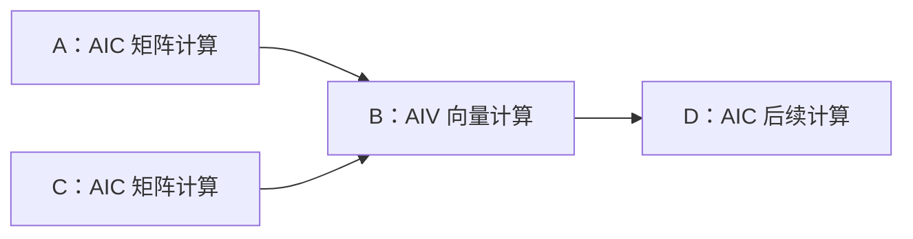
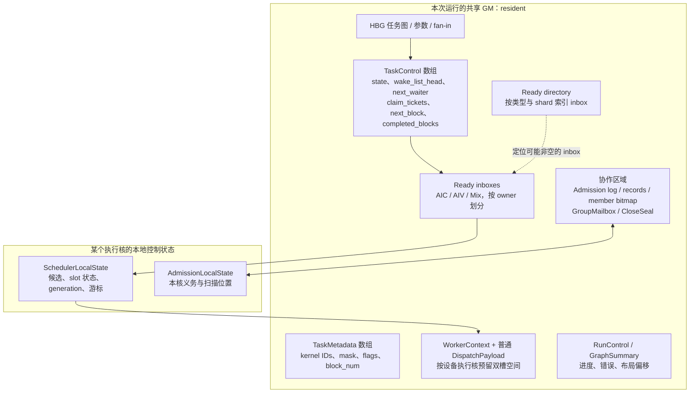
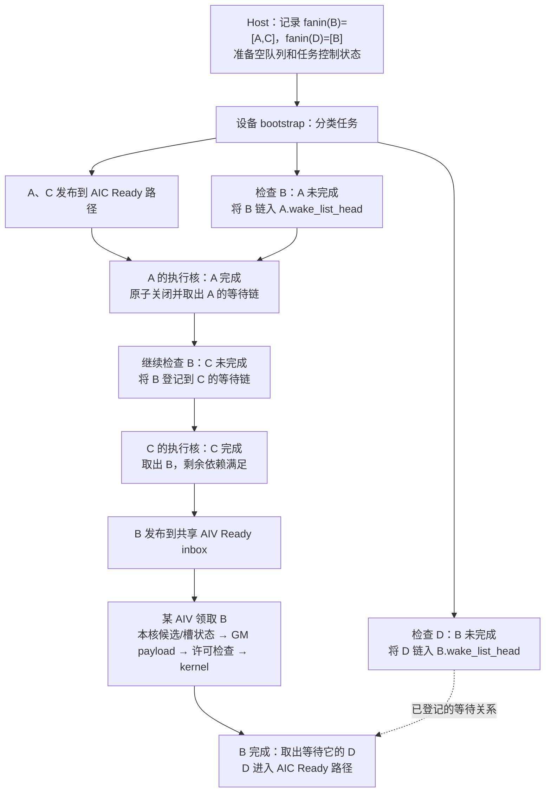
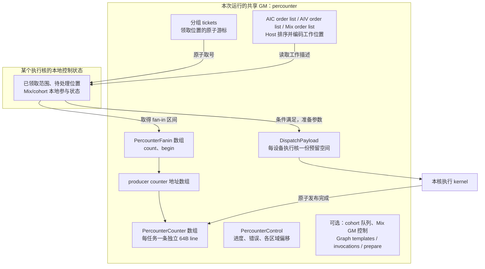
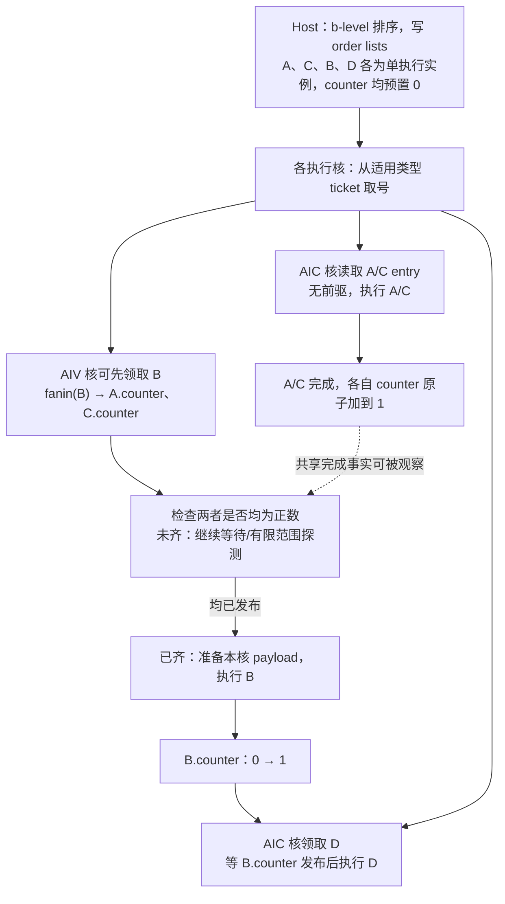
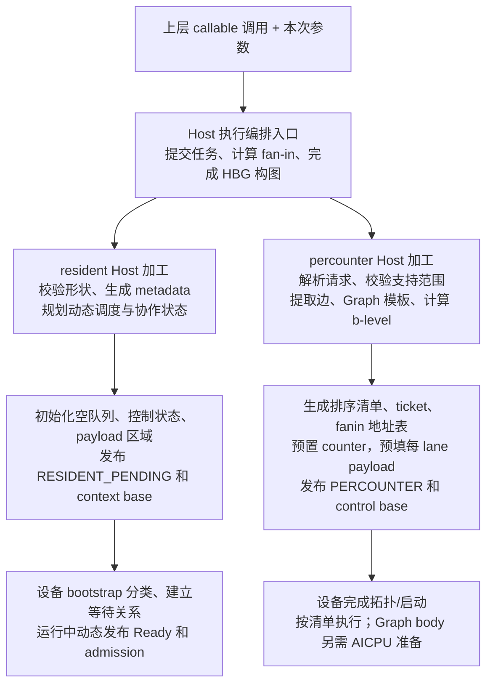

# A5 HBG：每核 resident 与 percounter 的 GM 流转及 Host 实现对比

> 历史资料：本文固定分析旧 resident 142ee15a7 与 percounter 9769943a，不描述当前默认 Ready pool。新版 resident 以 [理解指南](hbg-resident-vs-percounter-guide.zh-CN.md) 为准；原数据结构和性能证据保留用于版本对照。

建议先读[从术语、领取到等待链转挂的理解指南](hbg-resident-vs-percounter-guide.zh-CN.md)。该指南整合后续问答与经修正的五点归纳，补充 ticket/batch 映射、counter 探测、无依赖任务 bootstrap，以及 A 的等待链 B→C→D 中 B 转挂其他前驱的示例。本文保留 GM 布局与 Host 源码细节。

整理日期：2026-11-03。本文以已核对的固定提交为准，不宣称后续版本状态。

| 方案 | 固定提交 | 定位 |
| ---- | -------- | ---- |
| 每核 resident | `142ee15a7fa46925b9802984fa1ac75676e87d43` | 本次核对的 upstream/main 快照 |
| percounter | `9769943a58f4d7580dd23e6f6eff93067e7e9bbc` | PR #2814 head 快照，和上述 main 不是同一基线 |

结论：两者都由各执行核运行本地控制逻辑，没有额外的本核调度线程。resident 的共享 GM 维护动态等待链、就绪队列和协作状态；percounter 的共享 GM 维护预排清单、领取游标和完成计数器。Host 构图是共同前提，Host 对执行计划的加工方式不同。

## 1. 阅读约定与同一个示例

这里的 L2 Worker 管理一张芯片；设备 worker 是一个 AIC/AIV 执行核的运行时身份；lane 是该核在 cluster 内的位置。slot 是软件执行上下文槽，既不是 lane，也不是额外计算核。Scheduler 是本核控制循环，调用 kernel 后等它返回再推进。

GM 是共享设备内存；“归某核管理”不等于“只允许某核访问”。本核 local state 不复制整张图。下文布局图按逻辑分组，不代表严格地址顺序；省略 trace、PMU 等辅助区域。箭头表示访问或状态推进，不表示任务代码在区域间搬家：队列和清单主要保存任务身份/执行描述，kernel 代码另由注册表定位。

统一示例：四个普通、单 block、无 predicate 任务，不含 Mix 或 sync-start。



B 的 fan-in 是 `[A,C]`，D 的 fan-in 是 `[B]`。假设 B 检查依赖时 A、C 均未完成，之后 A 先完成、C 后完成。该时间线只是一个合法示例，实际可因 bootstrap 扫描和执行交错而不同。

## 2. 每核 resident：GM 中维护动态可执行状态

### 2.1 GM 分区与数据结构



主要结构及其含义：

| 对象 | 归属粒度 | 内容及访问方式 |
| ---- | -------- | -------------- |
| `SchedulerTaskMetadata` | 每 task 一份 | 16 字节；三个 kernel ID、active mask、flags、logical_block_num 等 |
| `SchedulerTaskControl` | 每 task 一份 | 512 字节；多核更新状态、链表和 block 领取/完成字段 |
| `SchedulerReadyInbox` | 每适用类型/owner 一份 | 128 字节；一个原子字打包 head/tail，链节点使用任务的 next_waiter |
| `SchedulerReadyDirectory` | 本次运行共享，内部按类型和 shard 划分 | 减少无效队列扫描；不是唯一正确性依据 |
| 普通 payload | 每设备执行核两个预留位置 | 位于 GM；普通路径本核准备、执行，不能理解成双 kernel 同时运行 |
| admission | 全运行共享控制/日志，每协作 task 记录及成员 bitmap | 发布共同顺序，各核维护自己的义务前沿 |
| `SchedulerGroupMailbox` | 每 cluster 一个当前 GM group mailbox | descriptor、published_seq 和三 lane 的 arrival/release ACK |
| close seal | 每 Mix task / candidate cluster | 直到 run 结束仍保留最终 group 关闭证据 |

普通队列不是“每 cluster 共用一条 FIFO”。AIC、AIV 类型各按自己的 type rank 定位 owner inbox，Mix inbox 由 AIC coordinator 类型序号组织。其他核可以向 owner 的 inbox 发布工作，符合规则的核可以在允许范围内 stealing。

以下是源码字段摘录，省略 padding/诊断字段，不是可以独立编译的结构定义：

```cpp
// SchedulerTaskControl
volatile int64_t state;
volatile int64_t wake_list_head;
volatile int64_t next_waiter;
volatile uint64_t claim_tickets;
volatile uint64_t admission_claim_lock;
int32_t next_fanin_index;
int32_t waiting_producer;
alignas(128) volatile uint64_t next_block;
alignas(128) volatile uint64_t completed_blocks;
alignas(128) volatile uint64_t admission_state;
```

同一个 `next_waiter` 可用于等待链、Ready 链或待发布 batch，但一个活跃任务不会同时属于这些链。完成解析先拆下等待链，再路由 waiter。独立原子字段与普通缓存回写区域分开，是防止跨核旧 cache line 覆盖链指针的协议要求。

### 2.2 A、C → B → D 的 GM 状态流转



这是按 fan-in 顺序推进的示例。不能想当然地让 B 同时挂在 A 和 C 两条 intrusive wake-list 上；它只有一个 next_waiter。若检查时前驱已完成，就继续检查；若登记与前驱关闭链竞争，CAS/重试负责避免丢唤醒。

核完成任务后调用 `scheduler_resolve_completion()`，关键动作是：

```cpp
int64_t waiter = scheduler_gm_exchange(
    control->wake_list_head, SCHEDULER_WAKE_LIST_CLOSED);
// 遍历已取出的 waiter，继续 route，形成 Ready batch 或直接候选。
```

普通单 block B 被领取后不需要再持续轮询 A、C 的完成值。依赖就绪与协作许可不同：即使 payload READY，仍要经过最终 entry gate。直接候选可能省略一次 Ready 入队，但不能跳过许可。

多 block 时，仅最后一个 block 完成才进入任务级后继释放；`completed_blocks` 的原子增量判断 TASK_LAST。Mix 由 AIC coordinator 发布 GM descriptor，各 lane 写自己的 ACK，全部必要释放后才能复用 mailbox。它们是普通示例以外的扩展，不能用一个 Ready 队列概括全部行为。

## 3. percounter：GM 中维护预排工作与完成事实

### 3.1 GM 分区与数据结构



主要对象：

| 对象 | 粒度及作用 |
| ---- | ---------- |
| order entry | 普通项以 64 位编码 task ID、block index、block count；sync-start 使用 arming entry |
| `PercounterTicket` | 64 字节隔离；普通类型按八个 lane 分组，负责各组映射到的列表位置，不等于硬件 cluster |
| `PercounterFanin` | 每普通任务 8 字节：count、begin；指向 producer counter 地址区间 |
| `PercounterCounter` | 每 task 64 字节；value 是完成状态，其他字段可承载 Graph body 定位信息 |
| payload | GM 每 lane 一份；Host 预填上下文固定地址，设备逐工作改写参数和 block 信息 |
| `PercounterControl` | 布局、拓扑/进度、错误等共享控制 |

```cpp
struct PercounterFanin { int32_t count; int32_t begin; };
// 普通任务的地址表项由 Host 计算：
fanin_addr[edge_cursor] = device_base + layout.counters_offset
    + static_cast<uint64_t>(producer) * sizeof(PercounterCounter);
```

因此 B 的执行者通过地址表直接读取 A.counter、C.counter。counter 不是“核自己的计数器”，而是当前任务的共享完成状态。预置值为 `1-N`，N 是必要 subtask 完成贡献数；执行完成原子加，按有符号值 `>0` 判断发布。领取唯一性由 ticket/协作协议保证，counter 本身不证明没有重复执行。

### 3.2 同一示例的 GM 状态流转



一种合法时间线：A 完成时 A.counter=1、C.counter=0，B 不执行；C 完成后两者为 1，持有 B 的核后续探测到条件成立，再执行 B。A/C 不查找 B、不修改 B 的队列成员关系。

若 A 有三个普通 block，初始 A.counter=-2，三个 block 依次贡献后为 -1、0、1；B 仍然只观察一个 A.counter。Host 的 AIC 清单则为 A 的三个 block 各生成一个 entry。清单位置被领取，不等于已执行，也不等于已满足依赖。

Mix 的召集信号在 cluster SSBUF，GM 保存其配套领取/放行等状态；sync-start 用共享 cohort 队列，不能把各 block 当普通项随意分波。Graph body 还会由 AICPU materialize 并发布 entry。percounter 不是全部状态都在 GM，也不是 AICPU 完全退出。

## 4. Host 侧：共同构图，不同的执行计划加工

### 4.1 两者共用的 HBG 前半段

上层向 L2 派发的是已注册 callable 的一次调用及本次参数，而非逐个物理核的工作。Host 加载编排 SO、绑定 RuntimeContext，在 scope 内调用编排入口；入口的 `rt_submit_*` 创建任务及参数、执行形状，通过显式 TaskId 或 TensorMap 推导 fan-in，写入任务表。

入口名即使叫 `aicpu_orchestration_entry`，HBG 仍在 Host 执行它。构图结束后才知道实际任务数、参数与中间 heap 用量。两个方案都消费这份图，没有把构图移到 AICore。



### 4.2 resident 的 Host 准备

`host/runtime_maker.cpp::create_scheduler_state()` 遍历构好的任务表：核对 kernel ID、mask、block 数、predicate 和参数边界；构建 `SchedulerTaskMetadata`，统计资源需求。GRAPH 或需要回退的形状选择 legacy，而不是部分任务混用 resident。

随后 `scheduler_plan_layout()` 计算区域大小与对齐，通过 `acquire_scheduler_state_storage()` 取得设备区和 Host mirror。`scheduler_init_data_from_layout()` 初始化队列、目录和任务控制；拷贝 metadata，恢复 bind 时已完成任务的 DONE/关闭链状态，初始化协作记录及 epoch，填 worker context 的布局偏移。

Host 在这里准备的是动态调度所需的容器和描述，不预先算出所有任务的固定执行清单，也不把运行时的 admission 顺序在 bind 时全部定死。实际核拓扑仍需设备启动发现，任务分类和等待链建立在设备 bootstrap 推进。

关键调用摘录：

```cpp
scheduler_plan_layout(...);
api->acquire_scheduler_state_storage(...);
scheduler_init_data_from_layout(host_base, layout, aligned_address);
// 初始化 metadata、协作记录、contexts 等。
runtime->publish_scheduler_bootstrap(
    SCHEDULER_RUNTIME_MODE_RESIDENT_PENDING,
    aligned_address + layout.worker_contexts_offset);
```

### 4.3 percounter 的 Host 准备

PR 的 `check_scheduler_request` / `select_percounter_state` 接入 `create_scheduler_state`。`SIMPLER_HBG_SCHEDULER_TYPE` 不设或空时保持默认选择；精确值 `percounter` 请求新路径，非法值导致 bind 失败。不支持形状返回默认选择，接受后布局/构建失败则报错，不能伪装为成功回退。

它复用默认遍历的 kernel/形状等校验，再从 TaskPayload 提取 fan-in，建立 `TaskInput[]` 和边数组；统计普通 block entries、Mix entries、sync cohorts。普通任务每 block 一项，sync-start 每任务一个 arming entry。

Host 逆向沿依赖边计算 b-level，按降序、同级 task ID 稳定排序；Graph shell 还按 body 深度加权。b-level 是后继链长度的优先级，不是精确 kernel 时长模型，也不等于 Host 已决定每项最终落在哪个物理核。物理分配仍由执行期 ticket 领取。

`plan_layout()` 规划 region，`build_tables()` 写清单、fanin 记录、producer counter 设备地址与预置值。每 lane payload 的上下文固定地址在 Host 填好，避免逐项重建不变部分。

```cpp
plan_layout(...);
api->acquire_scheduler_state_storage(...);
build_tables(inputs.data(), task_count, layout,
             host_base, device_base, external, &build, graph_plan);
runtime->publish_scheduler_bootstrap(
    SCHEDULER_RUNTIME_MODE_PERCOUNTER,
    device_base + layout.control_offset);
runtime->add_pending_metadata(
    device_state, host_base, layout.upload_size, ...);
```

`total_size` 与 `upload_size` 不必相等：为 Graph body counter 等保留的设备空间，可由 AICPU 准备后发布，不要求全部作为 Host 初始化前缀上传。Host 为每个 Definition 生成 template，每次 GRAPH 调用生成 invocation 并预留列表范围；AICPU 再按优先级分片 materialize body、flush 参数/任务存储、预置 counter、发布最长完整前缀。这不同于把 Graph body 所有内容都在 Host 一次写完。

### 4.4 Host 到底多做了什么，这些工作会花在哪里

**两者都先在 Host 上生成同一张计算图；区别是，构图之后，Host 还要为设备准备什么。** resident 主要准备“运行时调度所需的状态和容器”，percounter 还会把图加工成“执行核可以按位置领取的工作清单”。

#### 第一步：共同工作——先知道有哪些任务、谁依赖谁

两者都在 Host 执行编排入口，得到任务、kernel、参数、block 数和依赖。例如把本文示例中的 A 改为两个普通 block：

```text
A：AIC，2 blocks ──┐
                  ├─→ B：AIV，1 block → D：AIC，1 block
C：AIC，1 block ──┘
```

到这里，两者都知道：B 必须等 A 的两个 block 和 C 完成，D 必须等 B。这个依赖关系不是 percounter 才在 Host 算出的，resident 同样已经具备。

#### 第二步：不同工作——Host 分别准备两种执行方式

**resident 的 Host 准备：**保存 A、B、C、D 的执行描述，分配并初始化任务控制状态、Ready inbox、目录、执行参数槽，以及需要的协作记录。它不会把普通 A 的两个 block 都预先排进一份供所有执行核领取的固定清单。设备启动后分类任务，运行中再通过领取、完成处理和 Ready 发布推进。

**percounter 的 Host 准备：**读取相同依赖图，计算 b-level、排序，并按执行类型生成工作清单。普通多 block 按 block 展开；这个例子可形成：

```text
AIC 清单：[A/block0] [A/block1] [C/block0] [D/block0]
AIV 清单：[B/block0]

B 的依赖地址表：[A.counter 的地址，C.counter 的地址]
D 的依赖地址表：[B.counter 的地址]

A.counter 初始为 -1，累计两次完成后变成 1
B、C、D.counter 初始为 0，各自完成后变成 1
```

这是一种与排序规则相容的示意顺序。Host 排好了“清单位置”，但没有指定“block0 一定给哪个物理核”，也没有规定 A、C 的实际完成先后。物理核仍在设备执行时原子取号；B 或 D 即使已经被领取，也必须等依赖满足。

| 用直观问题比较 | 每核 resident 的 Host | percounter 的 Host |
| -------------- | --------------------- | ------------------ |
| 都要先构图吗？ | 要 | 要 |
| 额外准备的核心内容是什么？ | 任务状态、动态队列及协作状态 | 排序清单、取号器、counter 及依赖地址表 |
| A 有两个普通 block，如何表达？ | 任务记录 A 的 block 数，设备运行时领取 | Host 为 A 生成两个清单位置 |
| B 什么时候变得可执行？ | 设备完成处理推进依赖，再发布 Ready | 持有 B 的执行核发现 A、C 的 counter 都已发布 |
| Host 决定每项落在哪个核吗？ | 不决定 | 也不决定；预排序不等于预绑定物理核 |

#### 第三步：把准备工作交给设备

两者都要取得设备内存、准备 Host 镜像，并将必要的初始化数据传到设备。resident 告诉设备“从 worker context 区域开始读取配置”，percounter 告诉设备“从 percounter control 区域开始读取配置”。这只是两种布局的入口不同，不是另一次构图，也不是多一个调度线程。

GRAPH task 需要单独看：本文 resident 版本会选择 legacy；percounter 则由 Host 准备子图模板、每次调用的记录和预留位置，之后仍由 AICPU 准备、发布具体 body。因此不能说 percounter 在 Host 上一次性准备好了所有 Graph 执行内容。

#### 成本怎么理解：准备时间、上传时间、执行时间、占用空间分别看

| 成本 | 具体在问什么 | 为什么不能仅看设计就下结论 |
| ---- | ------------ | -------------------------- |
| Host 准备时间 | 构图之后，校验、规划、排序和填表用了多久？ | percounter 增加排序/清单加工，但 resident 也要初始化复杂状态；需要相同输入实测 |
| 初始化数据上传时间 | 启动前要传多少数据、发起多少次传输？ | 取决于实际上传字节和传输组织；预留的空间不一定全部上传 |
| 设备执行时间 | 运行时维护队列、领取、等待和协作花了多久？ | resident 付动态状态推进成本，percounter 付取号和轮询成本；收益依赖任务形状 |
| GM 占用 | 需要为这次运行预留多少设备空间？ | percounter 普通清单随 block 数增长；resident 有任务控制、队列、双槽及协作记录，不能只比较单个结构大小 |

例如，一个普通任务从 4 个 block 增加到 4096 个 block，percounter 的普通清单项数会明显增加；resident 仍用一条任务描述表达 block 数，但其执行记录等其他区域也可能增长。因此“counter 只有 64 字节，比 512 字节的 TaskControl 小”不等于“percounter 总内存一定更少”。

测量时至少分别记录：Host 准备耗时、初始化上传字节/耗时、Device wall 和 GM 区域大小。代码中的 `layout.total_size` 表示规划的调度状态区总空间，percounter 的 `layout.upload_size` 表示本次要上传的初始化前缀；两者都不是整个程序所有 tensor、kernel 和设备内存的总和。

**最终端到端收益要把准备、上传、设备执行和收尾一起计入，并考虑它们实际是否重叠。** 即使设备执行更快，新增的准备成本也可能抵消一部分收益；反过来，也不能只凭 Host 多做了排序就判断整体更慢。

## 5. 总结、验证边界与代码导航

| 对比维度 | 每核 resident | percounter |
| -------- | ------------- | ---------- |
| 核心抽象 | 任务状态机 + 动态就绪传播 | 有序工作位置 + 完成事实 |
| B 何时分配到执行核 | 普通路径依赖满足后领取 | 可在依赖满足前领取并持有 |
| A 完成后做什么 | 原子关闭等待链、推进 B、发布 Ready/直接候选 | 更新 A.counter，B 的持有者自行发现 |
| 动态热点 | 等待链、Ready 发布/领取、准入 | ticket、热门 producer counter、cohort |
| 是否私有整张图/整套队列 | 否 | 否 |
| 是否有独立本核调度线程 | 否，控制循环与 kernel 调用交替 | 同左 |

本次文档基于静态源码核对，没有运行新硬件测试。此前 CSA 的 7.20% 是 resident 内部负 Ready 探测复用的历史 A/B；#2815 的 Qwen3 Device 23.6% 是 percounter 对 legacy 的作者报告。两者不能相加，也不能证明 percounter 对当前每核 resident 的收益。

固定源码导航：

- [resident Host runtime_maker.cpp](https://github.com/hw-native-sys/simpler/blob/142ee15a7fa46925b9802984fa1ac75676e87d43/src/a5/runtime/host_build_graph/host/runtime_maker.cpp)：构图调用、校验、状态初始化与 bootstrap 发布。
- [resident scheduler_layout.h](https://github.com/hw-native-sys/simpler/blob/142ee15a7fa46925b9802984fa1ac75676e87d43/src/a5/runtime/host_build_graph/runtime/scheduler/scheduler_layout.h)：GM 区域偏移。
- [resident scheduler_types.h](https://github.com/hw-native-sys/simpler/blob/142ee15a7fa46925b9802984fa1ac75676e87d43/src/a5/runtime/host_build_graph/runtime/scheduler/scheduler_types.h)：TaskControl、Metadata、Inbox、Admission、Mailbox。
- [resident scheduler_ready.h](https://github.com/hw-native-sys/simpler/blob/142ee15a7fa46925b9802984fa1ac75676e87d43/src/a5/runtime/host_build_graph/runtime/scheduler/scheduler_ready.h)：route、wake-list、Ready 发布和领取。
- [resident aicore_executor.cpp](https://github.com/hw-native-sys/simpler/blob/142ee15a7fa46925b9802984fa1ac75676e87d43/src/a5/runtime/host_build_graph/aicore/aicore_executor.cpp)：本核状态、控制循环与最终进入检查。
- [percounter_state.h](https://github.com/deciding/simpler-percounter/blob/9769943a58f4d7580dd23e6f6eff93067e7e9bbc/src/a5/runtime/host_build_graph/host/percounter/percounter_state.h)：Host 选择、Graph 输入、region 初始化与上传。
- [percounter_plan.h](https://github.com/deciding/simpler-percounter/blob/9769943a58f4d7580dd23e6f6eff93067e7e9bbc/src/a5/runtime/host_build_graph/host/percounter/percounter_plan.h)：布局、b-level、清单和 producer 地址表。
- [percounter_types.h](https://github.com/deciding/simpler-percounter/blob/9769943a58f4d7580dd23e6f6eff93067e7e9bbc/src/a5/runtime/host_build_graph/runtime/scheduler/percounter/percounter_types.h)：counter、ticket、order 编码及协作结构。
- [percounter_executor.h](https://github.com/deciding/simpler-percounter/blob/9769943a58f4d7580dd23e6f6eff93067e7e9bbc/src/a5/runtime/host_build_graph/aicore/percounter/percounter_executor.h)：领取、依赖探测、执行和完成发布。
- [Issue #2815](https://github.com/hw-native-sys/simpler/issues/2815)、[PR #2814](https://github.com/hw-native-sys/simpler/pull/2814)：设计讨论与性能出处。
