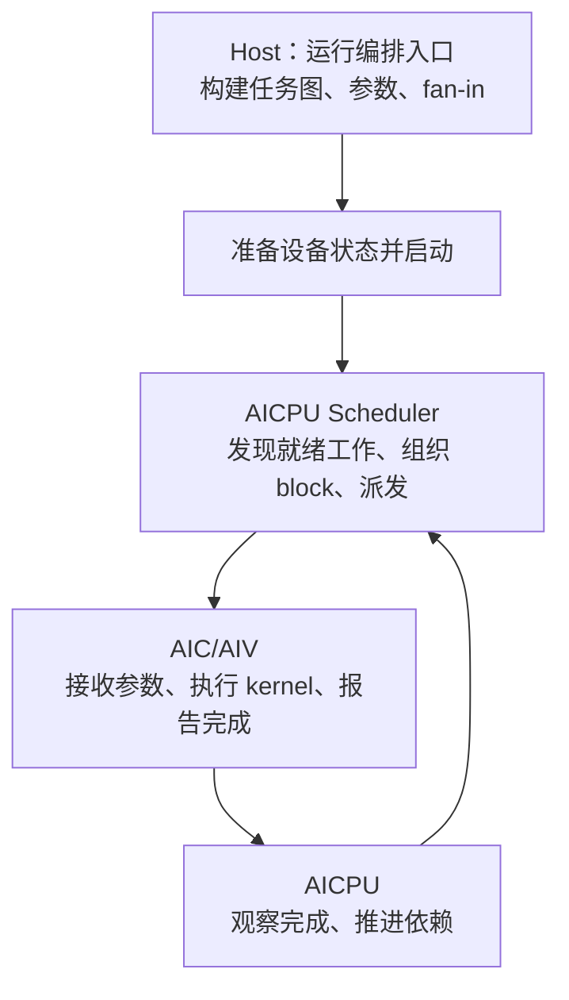
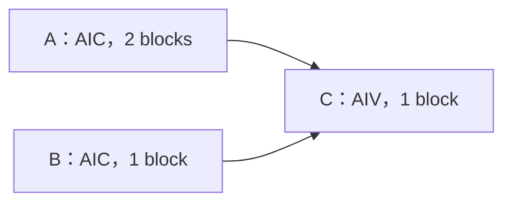
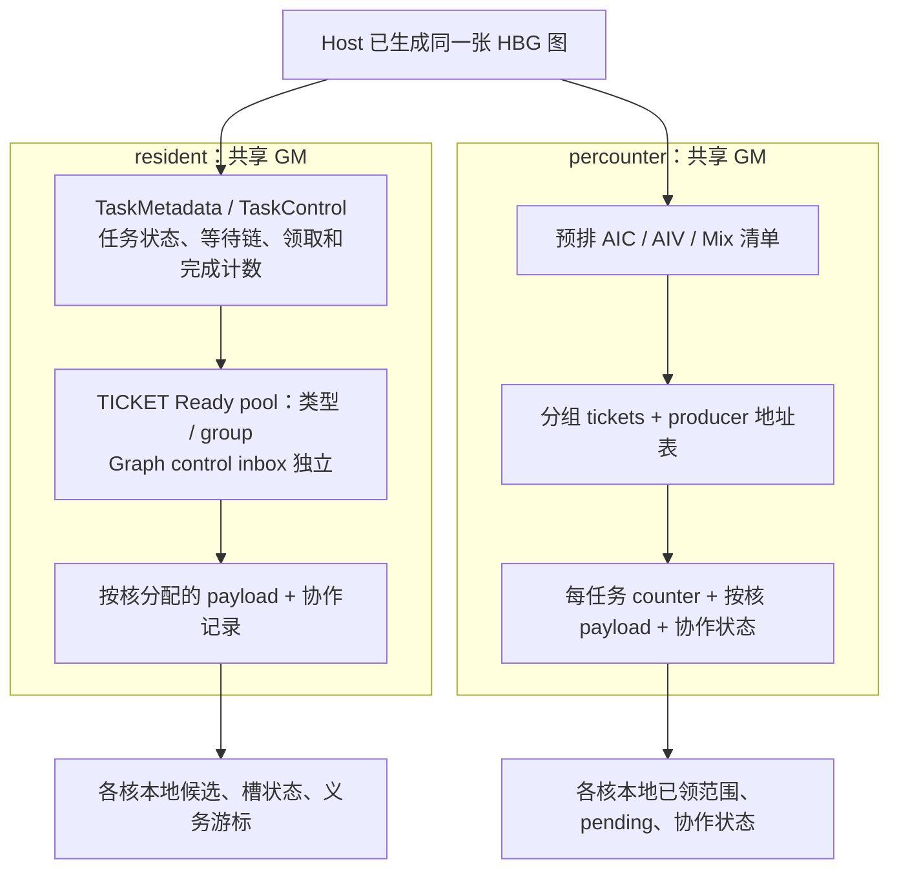
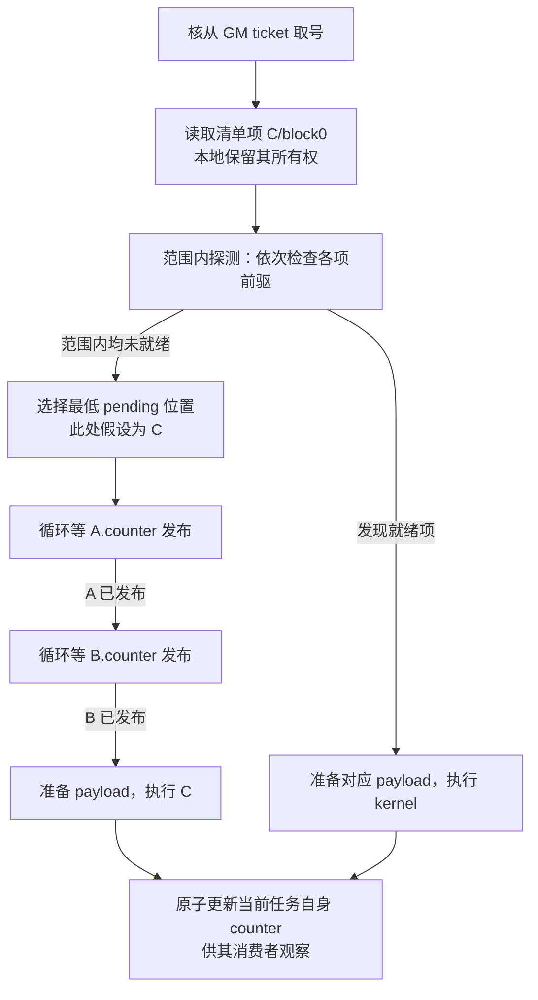
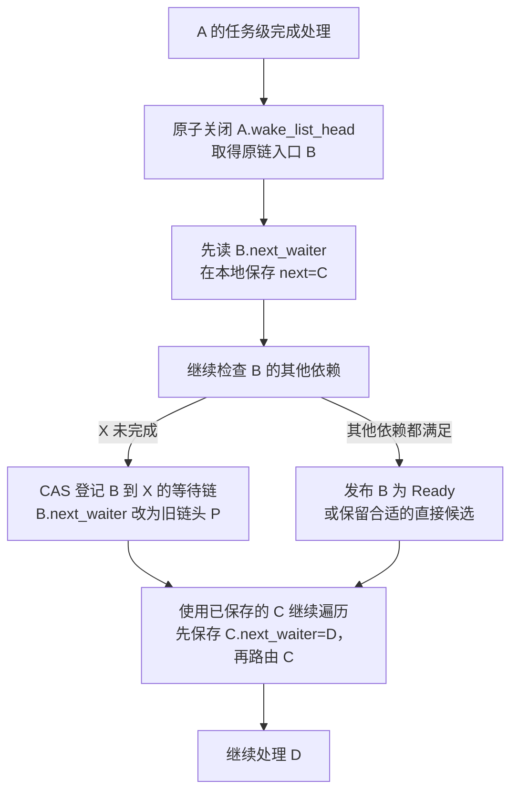

# 每核 resident 与 percounter：从 Host、GM 到 AICore 的理解指南

版本范围：每核 resident 以 2026-11-05 拉取的 `63ffeb8a8bd9b6527912fee87f6a8defdf82d5e0` 为准，默认 TICKET Ready pool / H8；percounter 固定为 PR #2814 的 `9769943a58f4d7580dd23e6f6eff93067e7e9bbc`。两者基线不同；本文没有新增硬件测试。旧 `142ee15a7` 的 owner inbox 与 Graph 回退仅作为历史说明。

阅读与测试：[离线 HTML](hbg-resident-vs-percounter-guide.html)、[真机操作与结果回填](README.md)。旧数据结构与性能证据保留在[历史 GM / Host 详解](hbg-resident-vs-percounter-gm-host.zh-CN.md)和[历史协作与性能分析](hbg-resident-vs-percounter-cooperation-performance.zh-CN.md)，其固定提交内容不能当作新版默认行为。

## 1. 先校准共同点和术语

两者都优化 A5 HBG 的设备运行时执行调度。Host 构建任务图，AICPU 保留启动、拓扑、监督和收尾职责；Graph 路径另有准备工作。每个 AIC/AIV 在本核运行控制循环，调用 kernel 后等待返回，再继续调度。没有额外创建本核调度线程；这里不否认计算硬件内部的流水能力。

| 名词 | 准确含义 |
| ---- | -------- |
| L2 Worker / ChipWorker | Host 上管理一张芯片、接收程序调用的运行时对象 |
| 设备 worker | AIC/AIV 执行核在运行时的身份，不是另一个 Python Worker |
| cluster lane | 核在硬件组内的位置，通常 0=AIC、1=AIV0、2=AIV1 |
| dispatch slot | 保存工作上下文的软件槽；双槽不表示两个物理核或两个 kernel 同时运行 |
| Task / block / kernel | 图内逻辑工作 / 该工作的执行份数 / 实际计算代码 |
| fan-in | 当前任务的前驱列表，例如 C 依赖 A、B |
| Ready | 必要依赖已满足，不等于完全没有依赖，也不等于已通过最终资源许可 |

一个 L2 调用可以生成很多 Task；普通 Task 可以有很多 block；Mix 的每个 block 可以有多个 active subtask，各执行对应 kernel。sync-start 要求容量内共同驻留；GRAPH Task 表示一次子图调用，不是所有 HBG 图的统称。

cluster resident 是较早的另一种职责划分：指定已有 AIV lane 为同组多个核调度，它自己也可以计算。每核 resident 将普通任务调度分散到各核。它们都没有凭空增加一个物理调度核；本文 resident 均指每核版本，不能与 percounter PR 旧基线中的 cluster resident 混为一谈。

### 1.1 起点：legacy 怎样执行 HBG

legacy 同样先由 Host 构建 HBG 图。区别在构图后的设备阶段：AICPU 调度线程观察完成、推进依赖、选择就绪工作并派发给 AIC/AIV；执行核接收 payload、调用 kernel、报告完成。实际派发可有双缓冲和提前准备，不是每个环节都完全串行。



这个分工使 AICore 主要负责计算，但任务推进依赖 AICPU 的派发和完成处理能力。大量短 kernel、高 fanout 或密集多 block 时，AICPU 控制吞吐、跨处理器交接和完成观察可能形成瓶颈。kernel 很长或图缺少并行度时，调度未必是主要瓶颈。

### 1.2 两条优化路线：共同下放职责，改变不同机制

| 问题 | legacy | 每核 resident 的思路 | percounter 的思路 |
| ---- | ------ | -------------------- | ----------------- |
| 谁安排执行工作？ | AICPU 调度线程 | 各执行核的本地控制循环 | 各执行核的本地控制循环 |
| 谁发现任务可运行？ | AICPU 依赖调度路径 | bootstrap/生产者完成处理动态推进 | 领取工作者检查 producer counter |
| 工作怎样分配？ | AICPU 派发给执行核 | Ready/直接候选，协作任务另领取 block | Host 排序，核原子领取 task/block 清单位置 |
| 主要省掉什么？ | — | 普通工作反复通过 AICPU 组织派发；更多转成本核处理 | 同时简化普通动态 Ready/wake-list 分发，减少集中派发 |
| 新成本是什么？ | AICPU 控制与核间交接 | 各核承担队列、依赖推进、准入和资源协议 | Host 排序填表，执行核取号、轮询、预领取等待和协作 |

resident 保留“完成后推动后继”的思想，将它分散到执行核，并通过共享队列连接不同核。percounter 利用完整图已知的条件，让 Host 提前形成候选顺序，核按清单拉取并自行等待前驱。两者不是单纯搬动同一段代码，也不是用一个额外后台线程替 AICore 调度。

共同收益目标是缩短 kernel 间的控制间隔、扩展工作分配吞吐；共同边界是必须保持依赖、唯一执行和资源释放正确。AICPU 并未被完全删除，Mix/sync-start 的必要协调也不能因“每核调度”而省略。优化目标不等于实测结论：不能推断所有图都加速，性能口径见第5节。

### 1.3 经修正的五点归纳

1. 两者都由本核控制逻辑调度，没有独立的本核调度线程。
2. 两者都以 Host 构建的 HBG 图为输入；图中依赖并非 percounter 才在 Host 计算。
3. percounter 在 Host 上增加 b-level 排序、普通逐 block 清单和 producer counter 地址表。resident 不生成同样的固定清单，但也需要校验、metadata、动态队列和协作状态初始化。
4. percounter 可以先领到未就绪的工作，由领取者检查前驱；resident 普通路径先将任务推进到 Ready，再取得任务，多个 block 随后通过协议分配。resident 还有直接候选路径，不一定每次都经过 Ready 入队。
5. percounter 完成后更新的是**当前任务自己的 counter**，供消费者读取；resident 的任务级完成处理取出自己的 wake-list，主动推进等待自己的后继。

## 2. Host 与 GM：同一张图，两种交付方式

统一例子：A 为 AIC 两个 block，B 为 AIC 一个 block，C 为 AIV 一个 block，C 同时依赖 A、B。



Host 都先运行编排入口，通过 rt_submit 创建节点、通过显式依赖和 TensorMap 等记录 fan-in。此时编排代码在执行，图内计算 kernel 尚未因此运行。

| Host 构图后的工作 | 每核 resident | percounter |
| ----------------- | ------------- | ---------- |
| 核心准备 | metadata/控制状态、Ready pool、Graph control inbox、双槽 payload、协作区 | b-level、分类清单、ticket、counter、依赖地址表、每 lane payload |
| A 有两个普通 block | 任务描述保存 block_num=2，设备运行时领取 | Host 生成 A/block0、A/block1 两个位置 |
| 启动后主要工作 | 设备分类任务、建立等待关系，动态推进 | 核按清单领取，检查 counter，执行并发布 |
| 是否预绑定物理核 | 否 | 否；列表位置不等于核编号 |

GM 存储是共享的，不是每核独占一张完整图。当前 resident 计算任务按类型和 group 存入 Ready pool，同类型消费者可跨组领取；Graph ENTER/EXIT 等控制节点使用独立 control inbox。percounter 的 order lists 按 AIC/AIV/Mix 分类，不为每核复制一份。



图中区域是逻辑分组。payload 虽归某核使用，仍可位于 GM；本核 local state 不等于这些共享结构的完整副本。Mix 还可能使用 SSBUF，不能将全部通信都归为 GM。

## 3. percounter：预排序、取号、检查依赖、发布完成

下面先串起完整流程，再解释容易混淆的领取和等待细节。表中以普通计算任务为主，协作任务在进入执行前走专门分支。

| 阶段 | 谁做、访问什么 | 结果及关键边界 |
| ---- | -------------- | -------------- |
| Host 构图 | 编排入口创建任务、参数与 fan-in | 得到依赖图，尚未执行图内 kernel |
| Host 加工 | 校验形状，计算 b-level，展开普通 block，规划 GM | 写 order lists、tickets、counter、依赖地址表；不绑定具体物理核 |
| 设备启动 | AICPU 发现拓扑、准备/发布启动配置，核解析本地配置 | Graph body 还需 AICPU materialize 后发布 |
| 领取 | 核 FAA 更新共享 group ticket，读取 GM 清单项 | 唯一获得一段候选位置，不保证其依赖已满足 |
| 就绪判断 | 先探测范围内可执行项；均不可执行时等最低 pending 项 | 通过 producer counter 判断，等待时仍服务必要协作 |
| 执行 | 准备 payload、按协议处理缓存可见性并调用 kernel | Mix/cohort 不走普通单核直执行路径 |
| 完成与退出 | 更新当前任务 counter，批量汇总进度 | 不遍历普通后继；Graph sink、Mix/cohort 另有完成动作；未收敛不能提前退出 |

### 3.1 b-level 排序与 block 展开是两件事

普通任务 b-level 表示到最远后继的链长度：末端为 0，前驱为后继最大值加 1。A→C 时，A 的 b-level 严格大于 C。按降序、同级 task ID 排列，既表达优先级，也保证生产者先于消费者。它不是精确 kernel 时间预测；Graph shell 另结合 body 深度。

排序后，普通任务按 block 展开。例如共享 AIC 清单可为 `[A/0,A/1,B/0]`，AIV 清单为 `[C/0]`。sync-start 使用 arming entry 和 cohort，不按普通方式把每个 block 交给普通清单领取。

清单顺序、取号顺序和实际执行顺序不同：不同组并行取号，依赖和资源决定能否执行，较后但就绪的已领项可以先运行。

### 3.2 ticket group、四位置块与 batch

ticket 是 GM 中的原子游标，**不是 ticket lock**。普通领取使用 FAA，而不是 CAS：

```cpp
base = scheduler_gm_fetch_add(cfg.tickets[group].next, batch);
```

操作返回旧值并加上 batch，唯一分配组内序号，没有持续持锁和解锁阶段。组内核共享游标；领到的工作不能被其他核重复领取。

ticket group 是软件分组，不是硬件 cluster。普通 AIC/AIV 类型域分别分组，分组参数为八个 lane；具体组数及成员由运行时拓扑与映射代码计算。这里的 lane 指参与循环的执行核，不能把八个 lane 理解成一个硬件 1C2V cluster。

假设两个组，清单每四个位置交错划归各组：

```text
全局清单：0 1 2 3 | 4 5 6 7 | 8 9 10 11 | 12 13 14 15 ...
归属：       G0   |    G1   |     G0    |      G1
G0序列： 0,1,2,3,8,9,10,11,16...
```

组内某个核取号，不是八个核一起领一块。batch=4 时，一个核可能一次领 0～3，另一个领 8～11；batch=1 时，多个核可分别领 0、1、2、3。四位置块决定归属，batch 决定一次领取数量。

当前代码的基准 batch=4，实际在 1/4 间调整：清单项数不超过同类型 lane 数×64，首次取 1，否则首次取 4；有实际 kernel 计时后，耗时至少约 3μs 取 1，较短取 4。尾部会截断。用于归属的四位置块不会随 batch 改变。

### 3.3 领到未就绪工作，不等于占着锁

领取的本质是先领唯一工作位置，再通过 fan-in 地址表检查 producer counter。counter 以有符号值解释，初始 `1-N`，累计完成贡献后到 1。A 有两个实例，所以 A.counter 从 -1→0→1；B 为 0→1。C 必须确认两者都发布。

这里有两种检查：范围探测调用 `percounter_fanin_ready()`，按前驱顺序读取，碰到一个未发布者就返回 false，下一轮可能重新探测；范围内均未就绪后，阻塞路径调用 `percounter_wait_for_fanin()`，先循环等 A，A 发布后再循环等 B。不是同时读取快照；完成状态在同次有效运行内单调，因此阻塞路径通过 A 后无需反复回头检查。代码也可复用已确认就绪任务的结果。



一个核已领范围内可能全部未就绪；它会等待最低 pending 位置，普通路径不会无限再领范围，也不会自动退回所有权。但等待仍须服务必要协作、退出和错误/超时检查。最低位置规则配合排序避免等待本核尚未执行的更早生产者。

最多持有4个普通清单条目，不一定是4个不同任务；同一多block任务可占多个位置。进入最低pending的阻塞等待后，不再扫描本批其他条目或领取下一批；直到当前条目可执行并返回主循环。其他核不能接手这些已领位置，Mix/cohort的checkpoint服务例外。

占用的是已领取位置、本核 pending 状态以及等待期间的执行机会，不是共享 ticket 锁。其他核可继续取号，但不能接手已领位置。这是预领取的负载均衡代价。范围内探测、小 batch、分组 ticket 可缓解，不能保证每核始终有活。

完成发布使用原子加：`scheduler_gm_fetch_add(cfg.counters[task.id].value, count)`，更新当前任务自身，不是给消费者的 counter 加一。A.counter>0 表示 A 完成，不表示 A 无依赖，也不证明某消费者的其他前驱已完成。counter 不单独保证恰好一次执行，唯一性由领取/协作协议保证。

### 3.4 Mix 与 checkpoint：领取者和参与者不同

普通Mix有独立清单，一个位置通常对应一个task/block，不沿用普通AIC/AIV的ticket group。各cluster的AIV0通过共享GM游标FAA(+1)唯一取号；本地claim可持有一个未就绪条目，依赖满足后才向本cluster的SSBUF signal发布task/block/mask/generation。

signal空闲与没有持有条目不是一回事：前者表示没有已发布且未释放的协作，后者表示AIV0没有已领但未发布的工作。AIV0不先扫描各lane的busy标志；参与lane在checkpoint发现请求，写本cluster SSBUF的arrived[lane]=generation，逐个检查mask内arrived，全部到齐才各自执行subtask。正在执行的kernel不会被抢占。

主循环先服务已放行cohort，再发现已发布Mix；已服务则回到循环顶部。随后尝试cohort领取、执行AIV0的Mix tick，才处理普通清单。新Mix若在tick里发布，可能要等下一checkpoint才参与；不能理解为所有Mix绝对优先。checkpoint也在前驱等待和drain阶段运行，已领取普通工作可以暂时让出执行机会服务协作。

参与者完成后写finished。mask最低编号lane等齐完成，再为当前任务counter增加popcount(mask)：表示这个block全部subtask的完成贡献。例如3个block、每block3个subtask，总共9份，counter初始1−9=−8，各block完成加3，依次−5、−2、1。AIV0回收signal后才能发起下一轮。sync-start Mix只有一个arming条目，之后走cohort分配block，不套用普通逐block清单流程。

## 4. 每核 resident：设备分类、Ready 领取与等待链转挂

完整主线与 percounter 对应如下。初始路由任务不是“领取它来计算”，最终执行者可能是另一个核。

| 阶段 | 谁做、访问什么 | 结果及关键边界 |
| ---- | -------------- | -------------- |
| Host 构图与准备 | 编排生成 fan-in，校验并规划共享 GM；native Graph规划ENTER/child/EXIT | metadata、TaskControl、Ready pool、控制inbox、双槽payload、协作区域；支持范围外仍须检查回退/拒绝 |
| 设备启动 | AICPU 发现拓扑、握手，各核初始化本地 Scheduler | 每设备执行核一套控制状态，不是新增线程 |
| bootstrap 分类 | 各核分担互不重叠的任务区间 | 已满足依赖者发布 Ready；未满足者登记到一个前驱的 wake-list，初始登记阶段有屏障 |
| 领取和 block 分配 | 从同类型Ready pool本组/其他组唯一领取，或取得直接候选 | 普通单block可进入准备；多block/Mix取得逻辑任务后发布准入，参与者再领取block |
| 执行 | 准备本核 payload，最终 gate 检查义务及许可，调用 kernel | Ready 只代表依赖就绪，不能跳过协作条件 |
| 完成 | 聚合 block；任务级完成关闭并取出自己的等待链 | 路由后继：转挂其他前驱，或发布 Ready/直接候选；不是修改静态 fan-in |
| 收尾 | 完成本核义务、group 释放、发布与生命周期收敛 | 任务计数达到目标也不能忽略仍在使用的资源 |

### 4.1 无依赖任务何时进入 Ready

Host 已知 fan-in 为空，但不直接替设备完成初始 Ready 入队。普通任务在设备 bootstrap 被分类：无 fan-in 直接判定 READY_TO_ENQUEUE，有 fan-in 则路由检查；按类型汇成 batch，再按task_ref映射group，发布Ready pool。Graph控制节点另走control inbox。

```text
Host：任务描述、fanin=[]、初始化空队列
    → 设备 bootstrap 分类并发布 Ready
    → 某核取得任务
    → 单 block 准备/检查后执行；多 block 组织准入与 block 领取
```

Ready 表示依赖已满足，不是任务天生没有依赖。多 block 任务从队列取得一次，不表示领取者独占全部 block；其他参与核通过 admission 记录发现义务，再用任务级原子领取状态取得 block。kernel 入口前仍有 gate，防止违反协作资源顺序。合适后继也可以保留为直接候选，省略一次 Ready 入队/出队。

### 4.2 fan-in、wake-list、next_waiter 不能混用

| 数据 | 挂在哪里 | 含义 |
| ---- | -------- | ---- |
| C 的 fan-in | C 的任务参数/依赖区域，GM | C 依赖哪些任务，例如 `[A,B]` |
| A.wake_list_head | A 的 TaskControl，GM | 当前登记等待 A 的链表入口 |
| C.next_waiter | C 的 TaskControl，GM | C 所属链的下一节点，不是 C 的前驱 |

一个任务可有很多后继，wake-list 可包含多个 waiter。但它是运行时当前等待者集合，不一定等于全部静态后继。一个 waiter 只有一个 next_waiter，不能同时挂在多个 intrusive 等待链上；字段也可用于 Ready 链，不是永久依赖边。

### 4.3 A 的等待链为 B→C→D，B 还有其他前驱 X

```text
初始共享 GM：
A.wake_list_head → B → C → D → END
B.next_waiter=C，C.next_waiter=D
B.fan-in 包含 A、X；X 尚未完成
X.wake_list_head → P → Q → END
```



A 的完成核不是从 B 的“依赖列表中删除 A”，而是取走 A 自己的等待链，再继续推进 B 的 fan-in 检查。若 X 未完成，正在路由 B 的 Scheduler 将 B 转挂到 X，X 完成后继续处理；若 X 已完成则跳过，继续后面的依赖，全部满足才发布 Ready。

顺序必须是“取链入口 → 保存当前 next → 路由当前节点 → 使用保存的 next”。因为路由会改写 B.next_waiter，若不先保存 C，就可能把原链遍历误导到 X 的链上。GM 只是数据，不会自己定时扫描；实际遍历者是运行完成处理的 Scheduler。

登记与完成可能竞争：X 恰好关闭等待链时，登记者必须通过原子协议发现竞争并重试/继续推进，不能把 B 留在无人再处理的已关闭链上。链指针关键读写需要设备原子可见性保证，不能用任意缓存读取代替。

### 4.4 回到统一例子：A、B→C

一种合法流转是：bootstrap 检查 C，先等 A；A 的最后一个 block 完成后取出 C，发现 B 未完成，转挂到 B；B 完成后再取出 C，发布 AIV Ready。若 A 完成时 B 已结束，则直接将 C 推进到就绪。无需一个固定的 C 执行核不断轮询 A、B。

多 block 完成需先聚合，只由最后一次完成推进逻辑任务的后继。Mix 还需等待必要 lane 释放；LocalDone 表示本核义务结束，TaskDone 才表示整个任务完成并可释放真实依赖。这里的“生产者推动”不意味着消费者路径从不观察前驱，而是不以消费者持续轮询全部前驱作为主要就绪发现机制。

### 4.5 Ready pool 的 GM 组织与 group 规则

当前默认TICKET/H8于PR #2864的bd131362e引入。63ffeb8a8相对它没有A5 HBG runtime目录改动。Ready pool包含128字节header、每队列16字节descriptor、256字节control，以及每位置8字节task_ref entries。head与reserved_tail各占独立128字节区域；entry初始INVALID，发布后本run不覆盖、不循环复用。Host按任务类型和目标group计算容量，不预排实际Ready顺序。

```text
共享GM
  TaskMetadata / TaskControl / fan-in / wake-list
  Ready pool
    header：类型、group数、各区域偏移
    descriptors：每队列entries_offset、capacity
    controls：每队列head、reserved_tail
    entries：Ready逻辑任务引用
  Graph control inboxes：ENTER/EXIT等控制节点
  admission log/record/control + 每cluster的GM Mix mailbox
  各核payload
核本地：候选、执行槽状态、admission游标、Mix阶段
```

消费者本组由同类型rank确定：`own_group = type_rank / 8`。本次运行有C个完整cluster、每组1C2V时，AIC/Mix各有ceil(C/8)个group，AIV有ceil(2C/8)个group。Mix由已有AIC coordinator消费，不增加核；group是软件分组，不是硬件cluster。

任务目标由`hash(task_ref / 4) % group_count`决定，实际代码使用整数混合。连续4个引用同组输入，任务类型先决定队列集合。不是发布者所在cluster选owner，不是寻找最空闲group，也不是绑定最终执行核。消费者多数搜索先本组再远端，每第四次搜索先远端；同类型可跨group争领。group数为1时自然退化成该类型一个共享队列。

发布：FAA(reserved_tail,count)唯一预留区间，之后写entries并完成发布。领取：读head及entry，CAS(head,head+1)成功者取得逻辑任务。预留不等于已发布；队首entry尚INVALID可暂时挡住后面已发布项。当前默认路径每次返回一个逻辑任务，不是percounter预领的block清单。批量发布与批量领取是两回事。

| 机制 | 历史owner inbox | 当前默认Ready pool |
| ---- | --------------- | ------------------ |
| 发布归属 | 发布者cluster、类型等决定owner | 类型与task_ref决定group |
| 入队/出队 | CAS同一个打包head/tail字 | FAA预留tail，CAS推进独立head |
| 可达范围 | 普通路径的directory shard | 同类型group全范围可访问 |
| 任务顺序 | 动态发布顺序 | 动态预留/发布顺序，不是b-level静态清单 |
| 保留用途 | 旧计算路径代码、控制节点队列helper | 计算任务默认路径 |

### 4.6 逻辑任务领取核、参与核与推进后继核

| 任务 | 领取与执行组织 | 推进后继者 |
| ---- | -------------- | ---------- |
| 纯AIC/AIV单block | 一个同类型核领取并执行 | 完成该任务的核 |
| 纯AIC/AIV多block | 一核领取并推进admission；本次运行拓扑的同类型核成为成员，按协议争领block | 提交block完成计数、确认整个任务完成的核 |
| Mix单/多block | 一AIC领取并推进admission；成员覆盖候选cluster全部lane，各AIC coordinator争领block、本cluster按active mask执行subtask | 收齐本组释放后，贡献整个任务最后一次block完成计数的coordinator |

group不限定执行团队。成员有资格参与，不保证都领取到block；Mix控制成员也不等于实际计算lane。后继推进者不一定是最初领取任务者。完成贡献通过FAA(completed_blocks,1)判断是否为最后一次，而不是单独观察某核kernel返回时刻。

Ready发现与真正执行有两个优先级层面：AIC的普通/Mix队列按候选位置和游标轮换探测，没有绝对Mix优先。多block/Mix取得任务后发布admission；各核按共享日志顺序履行本地成员义务，类型不再单独排序。普通kernel入口要求本核没有pending/current义务，并已扫描到commit_tail；已经运行的kernel不抢占，未执行的普通候选可以暂存。

AIC自身Mix subtask返回后，可以处理完成事件、发现有限候选、推进发布和轮询release，但不能直接执行普通kernel，也不能在本组退休前复用协作状态领取下一block。组内退休后可继续争领当前Mix的block；无block且满足关闭条件后，关闭本地义务、推进后续admission，再按许可执行普通任务。本地关闭不要求全芯片其他cluster都已完成。

### 4.7 Native Graph 与仍在使用的 inbox

旧142ee15a7遇GRAPH整次选择legacy；当前Host将受支持的Graph调用规划为ENTER、child DAG、EXIT。child依赖、实例参数绑定与退出join保留，计算child可走AIC/AIV/Mix Ready pool及既有admission；ENTER/EXIT等控制节点进入每worker的control inbox，由scheduler_service_controls有限预算处理，也可探测其他worker的控制inbox。

因此不能说所有inbox都被移除，也不能说所有Graph节点都走计算pool。普通HBG DAG与Graph Definition调用/replay仍是不同概念；支持范围内的Definition调用现可走native resident，不再一律回退。新实现的具体限制应以最新源码和[Graph设计文档](../docs/zh-cn/design/a5-hbg-graph-task.md)为准，不将历史percounter或旧resident的支持结论外推。

代码依据：[pool布局](../src/a5/runtime/host_build_graph/host/ready_pool_plan.h)、[TICKET协议](../src/a5/runtime/host_build_graph/runtime/scheduler/scheduler_ticket_queue.h)、[发布/领取](../src/a5/runtime/host_build_graph/runtime/scheduler/scheduler_ready.h)、[admission](../src/a5/runtime/host_build_graph/runtime/scheduler/scheduler_admission.h)、[控制节点](../src/a5/runtime/host_build_graph/runtime/scheduler/scheduler_graph_control.h)。

## 5. 最终对照

| 问题 | 每核 resident | percounter |
| ---- | ------------- | ---------- |
| 谁调度 | 每执行核本地控制循环 | 同左 |
| 图在哪里构建 | Host | Host |
| Host 交付重点 | 动态状态和容器，设备分类推进 | 预排清单、counter 和地址表 |
| 核领取的对象 | Ready 逻辑任务；多 block 另有任务内领取 | 普通清单的 task/block 位置，可批量 |
| 前驱未完成怎么办 | 路由者登记等待链，通常未绑定最终执行核 | 领取者保留工作并观察 producer counter |
| 当前任务完成后 | 拆自己的 wake-list，推进后继 | 加自己的 counter，由消费者发现 |
| 共享热点 | 等待链、pool的FAA/CAS、跨组探测、control inbox、admission | tickets、counter 轮询、cohort |
| 跨核协作 | admission、成员义务、GM Mix 等 | 排序、SSBUF Mix、cohort 等 |
| GRAPH 支持 | native ENTER/child/EXIT；计算pool与控制inbox分流 | PR 增加模板、invocation 和 AICPU body 准备 |

两者的“每核调度”职责分布相似，但依赖发现、领取粒度、协作方法与支持范围不同。resident 主要将 legacy 的动态调度责任分散到各核；percounter 还用 Host 预排清单和完成计数替换普通路径的动态 Ready/wake-list 分发。前者可能集中消耗在后继路由、队列和准入，后者可能集中消耗在取号、依赖轮询和预领取不均衡；都没有消除必要协作。

| 历史测量 | 起点→终点 | 收益含义 |
| -------- | --------- | -------- |
| resident，CSA | 已有 resident → 增加同轮负 Ready 探测复用 | Device 2.245264→2.0835975ms，下降7.20%；是局部增量，不是 legacy→resident 总收益 |
| percounter，Qwen3 | 含 Graph、默认 legacy → percounter | Device 29.767→22.751ms，下降23.6%；Host 31.182→24.291ms，下降22.1%；作者报告，不是对当前每核 resident 的比较 |

性能需要同输入、同工具链、固定提交比较。这两组数字的基线、workload 和部分指标均不同，不能相加或用来判断每核 resident 整体只有7%的提升。实际选择还应检查形状支持、实际 scheduler mode，以及数值和协议验收；完整证据边界见协作与性能配套文档。

新版Ready pool的设计目标不等于实测加速。[PR #2864无Graph测量](../docs/zh-cn/design/a5-hbg-graph-task/no-graph-performance.md)记录过性能门禁未通过；[Qwen记录](../docs/zh-cn/design/a5-hbg-graph-task/qwen-performance.md)也有退化，且固定候选、设备、PTO-ISA不同。不能将历史候选数字改标为63ffeb8a8的新测量，更不能单独归因于Ready pool。
